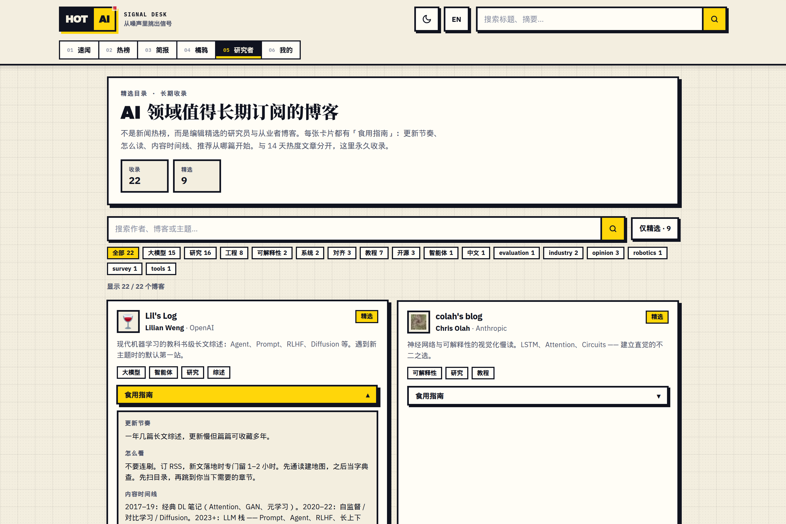

# Hot AI

A live multi-source news reader with a ranked AI intelligence module—pairing an account-free RSS timeline with 14-day AI story ranking, daily digests, and source-cited streaming Q&A ([hotai.yeuxark.com](https://hotai.yeuxark.com)).

English · [简体中文](README.zh-CN.md)

| Ranked AI Feed (`/hot`) | Curated Blogs (`/blogs`) |
| --- | --- |
|  |  |

## Features

- **Live multi-source reader (`/`)** — Aggregates general, tech, and editorial RSS/Atom/JSON feeds in memory without database writes; includes an SSRF-guarded Readability reader (`/r`), Juya daily brief (`/juya`), and browser-local custom feeds with OPML import/export (`/subscribe`).
- **Ranked 14-day AI module (`/hot`)** — Hourly worker (`apps/fetcher`) pulls arXiv, HuggingFace, GitHub Trending, and tech media, merges canonical URLs and 3-day cross-source reposts, and ranks stories by source weight, 24h time decay, engagement signals, and LLM importance.
- **Optional AI summaries, digests & Q&A** — Uses the Anthropic `/v1/messages` protocol to batch-enrich articles, synthesize daily top-40 briefs (`/digest`), and stream answers grounded in the past 48h of stories with in-app `[n]` citations (`/api/ask`); runs cleanly with AI disabled when no key is set.
- **PostgreSQL-coordinated guardrails** — Cross-process leases prevent duplicate fetch cycles and digest runs, while `/api/ask` enforces per-IP rate limits, corpus-pinned citation caching, and fail-closed daily token budgets.
- **Open feeds & observability** — Publishes RSS 2.0 (`/feed.xml`), JSON Feed 1.1 (`/feed.json`), and curated OPML (`/hotai.opml`), alongside `/api/live`, `/api/health`, and Bearer-gated Prometheus `/api/metrics`.

## Quick Start

Requires **Node.js 22.22.2+**, **pnpm 9.12** (via Corepack), and **PostgreSQL 15+**.

```bash
docker run -d --name hotai-pg -p 5432:5432 \
  -e POSTGRES_USER=hotai -e POSTGRES_PASSWORD=hotai -e POSTGRES_DB=hotai \
  postgres:15

pnpm install
cp .env.example .env      # optional: set ANTHROPIC_API_KEY or ANTHROPIC_AUTH_TOKEN
pnpm db:generate
pnpm db:migrate
pnpm db:seed
pnpm fetch:once           # run one fetch + optional AI enrichment/digest cycle
pnpm dev:web              # http://localhost:3000
```

## Verification

```bash
pnpm test           # Vitest unit suites (set RUN_DB_TESTS=1 for Postgres integration)
pnpm typecheck      # TypeScript check across db, ai, fetcher, and web
pnpm lint           # ESLint flat config for apps/web
pnpm release:check  # read-only pre-release content and readiness gate
```

## Architecture & Documentation

```text
apps/web        Next.js 16 App Router — live RSS reader (/), ranked AI views (/hot, /digest), and /api/ask
apps/fetcher    Hourly Node.js worker — source ingestion, deduplication, scoring, AI batching, and digest refresh
packages/db     Shared Prisma schema/client, seed catalog, and cross-process PostgreSQL coordination leases
packages/ai     Anthropic /v1/messages wrapper with explicit third-party relay opt-in and soft-degrade guards
```

- [docs/CURRENT_BEHAVIOR.md](docs/CURRENT_BEHAVIOR.md) — Canonical runtime behavior, 14-day retention rules, and UI contracts
- [docs/DEPLOYMENT.md](docs/DEPLOYMENT.md) & [deploy/README.md](deploy/README.md) — Route/API reference, AI pipeline & relay configuration, systemd/Nginx setup, and production runbook
- [docs/design.md](docs/design.md) & [docs/ART_REQUIREMENTS.md](docs/ART_REQUIREMENTS.md) — Scope boundaries, architecture decisions, and Signal Press visual assets
