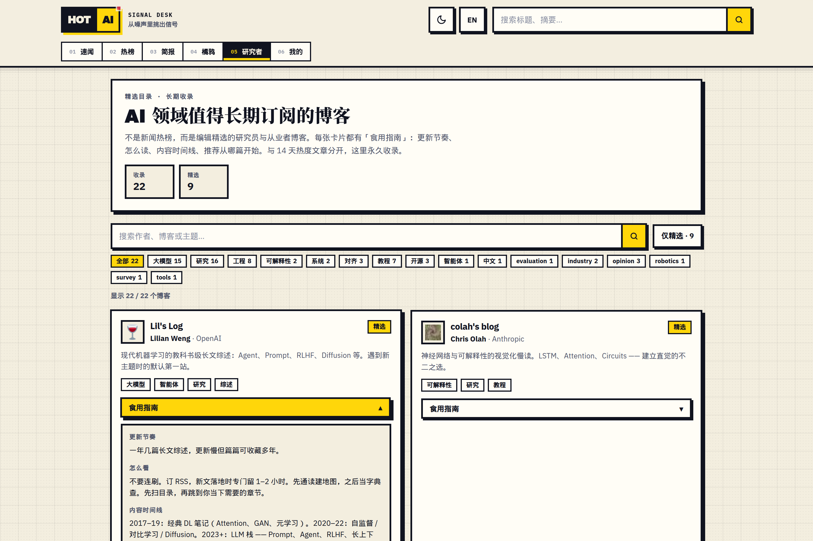

# Hot AI

无账号多源速闻阅读器与 AI 资讯模块：默认首页直连多源实时 RSS 时间线，独立模块提供 14 天入库 AI 热榜、每日简报与带站内引用的流式问答（在线站点：[hotai.yeuxark.com](https://hotai.yeuxark.com)）。

[English](README.md) · 简体中文

| AI 热榜模块（`/hot`） | 精选博客目录（`/blogs`） |
| --- | --- |
|  |  |

## 核心特性

- **实时多源速闻（`/`）** — 服务端内存缓存聚合通用要闻、科技媒体与编辑源 RSS/Atom/JSON Feed，不写入数据库；内置带 SSRF 防护的正文阅读器（`/r`）、橘鸦早报（`/juya`），以及保存在浏览器本地的自定义源与 OPML 导入导出（`/subscribe`）。
- **14 天入库 AI 热榜（`/hot`）** — `apps/fetcher` 每小时抓取 arXiv、HuggingFace、GitHub Trending 与科技媒体，合并规范化 URL 与 3 天内跨源转载，按来源权重、24 小时时间衰减、互动信号与模型重要度综合排序。
- **可选的 AI 摘要、简报与问答** — 基于 Anthropic `/v1/messages` 协议批量生成中英双语摘要、合成每日 Top-40 简报（`/digest`），并基于近 48 小时入库文章提供带站内 `[n]` 引用的 SSE 流式问答（`/api/ask`）；未配置密钥时全站自动降级运行。
- **PostgreSQL 跨进程协调与成本护栏** — 通过数据库租约防止多进程重复抓取或重复生成简报；`/api/ask` 叠加单 IP 限流、绑定语料版本的引用快照缓存与失败关闭（fail-closed）的每日 Token 配额阀。
- **开放订阅与可观测性** — 原生输出 RSS 2.0（`/feed.xml`）、JSON Feed 1.1（`/feed.json`）与精选源 OPML（`/hotai.opml`），并提供 `/api/live`、`/api/health` 与 Bearer 鉴权的 Prometheus `/api/metrics` 端点。

## 快速开始

环境要求：**Node.js 22.22.2+**、**pnpm 9.12**（通过 Corepack 启用）、**PostgreSQL 15+**。

```bash
docker run -d --name hotai-pg -p 5432:5432 \
  -e POSTGRES_USER=hotai -e POSTGRES_PASSWORD=hotai -e POSTGRES_DB=hotai \
  postgres:15

pnpm install
cp .env.example .env      # 可选：填写 ANTHROPIC_API_KEY 或 ANTHROPIC_AUTH_TOKEN
pnpm db:generate
pnpm db:migrate
pnpm db:seed
pnpm fetch:once           # 手动执行一轮抓取与可选的 AI 摘要/简报生成
pnpm dev:web              # 启动前端 http://localhost:3000
```

## 校验与构建

```bash
pnpm test           # Vitest 单元测试（设置 RUN_DB_TESTS=1 可运行 Postgres 集成测试）
pnpm typecheck      # 全工作区 TypeScript 类型检查（db、ai、fetcher、web）
pnpm lint           # apps/web ESLint 检查
pnpm release:check  # 发布前只读内容与就绪门禁校验
```

## 架构与文档

```text
apps/web        Next.js 16 App Router — 实时速闻首页（/）、AI 热榜与简报（/hot、/digest）及流式 /api/ask
apps/fetcher    Node.js 定时工作进程 — 多源抓取、去重打分、AI 批量富化与简报刷新
packages/db     共享 Prisma Schema/Client、初始订阅源（seed）与跨进程 PostgreSQL 协调租约
packages/ai     Anthropic /v1/messages 协议封装，支持第三方中转显式 opt-in 与无密钥静默降级
```

- [docs/CURRENT_BEHAVIOR.md](docs/CURRENT_BEHAVIOR.md) — 当前运行行为合同、14 天数据保留策略与前后端边界
- [docs/DEPLOYMENT.md](docs/DEPLOYMENT.md) 与 [deploy/README.md](deploy/README.md) — 完整路由/API 表、AI 流水线与中转配置、systemd/Nginx 部署及运维手册
- [docs/design.md](docs/design.md) 与 [docs/ART_REQUIREMENTS.md](docs/ART_REQUIREMENTS.md) — 产品范围边界、架构取舍与 Signal Press 视觉资产说明
